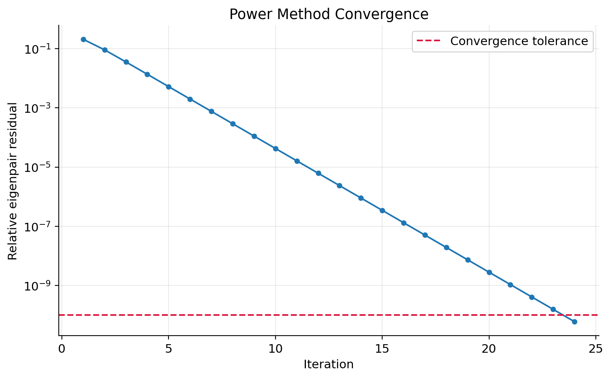
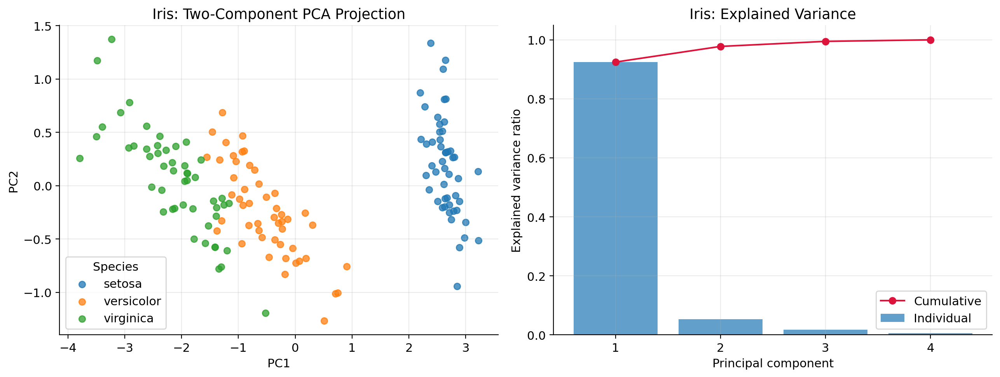
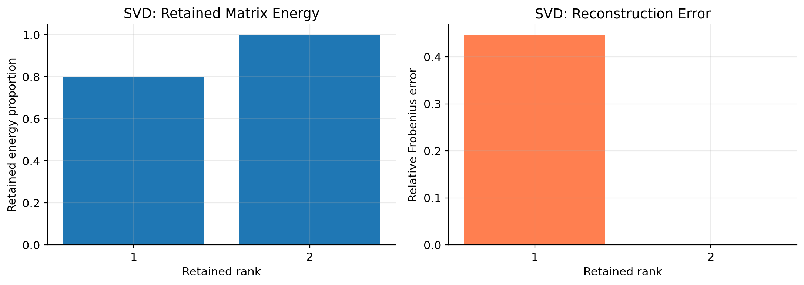
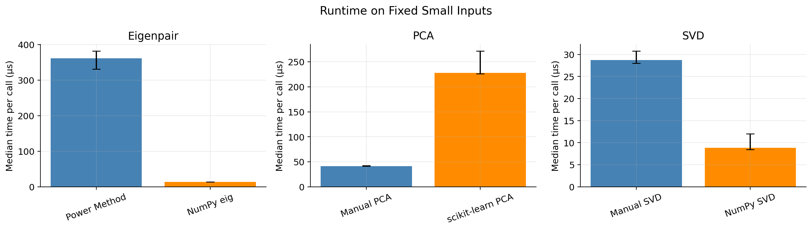

# Linear Algebra for Data Science
### Eigenvalues, PCA, and Singular Value Decomposition

Educational implementations of the Power Method, Principal Component
Analysis (PCA), and Singular Value Decomposition (SVD), with numerical
validation against NumPy and scikit-learn.

The project connects mathematical concepts to working Python code through
accuracy checks, visualizations, low-rank reconstruction, and repeated
runtime measurements.

## Project Overview

| Technique | Implementation | Reference |
|---|---|---|
| Eigenvalues and eigenvectors | Power Method for a dominant eigenpair | `numpy.linalg.eig` |
| PCA | Covariance eigendecomposition | `sklearn.decomposition.PCA` |
| SVD | Gram-matrix eigendecomposition with paired singular vectors | `numpy.linalg.svd` |

The PCA and SVD implementations use NumPy's eigendecomposition routines
as building blocks rather than implementing every numerical solver
from scratch.

## Key Results

- **Eigenpairs:** The Power Method matched NumPy's dominant eigenpairs
  for symmetric and nonsymmetric example matrices.
- **PCA:** Two components retained approximately **97.77%** of the variance
  in centered, unscaled Iris data. Explained variances and projected
  scores matched scikit-learn after sign alignment.
- **SVD:** Both example matrices were reconstructed with relative errors
  around **2 × 10⁻¹⁶**.
- **Low-rank approximation:** One component retained **80%** of the
  rank-deficient example matrix's Frobenius energy.
- **PCA–SVD connection:** The analysis verified the relationship between
  covariance eigenvalues, squared singular values, and component directions.

## Visualizations

### Power Method Convergence



### PCA on Iris



### Low-Rank Approximation



### Runtime Comparison



## Runtime Findings

The notebook uses warm-up calls and nine timing batches of 100 calls each,
reporting median time per call and the interquartile range.

In the initial measured run, NumPy was faster for eigenvalue computation
and SVD, while manual PCA was faster on the small Iris input.

These comparisons involve different algorithms, overhead, and—in the
eigenvalue case—different output scopes. They do not establish general
performance rankings or scalability.

## Repository Contents

| Path | Description |
|---|---|
| `notebooks/linear_algebra_pca_svd.ipynb` | Executed analysis, implementations, and validation |
| `figures/` | Figures exported by the notebook |
| `requirements.txt` | Python dependencies |
| `.gitignore` | Excludes local environments and temporary files |

## Data and Examples

No external data download is required.

- Small matrices are defined directly in the notebook.
- Synthetic data is generated using a fixed random seed.
- Iris is loaded through `sklearn.datasets.load_iris`.

Species labels are used only for visualization, not to fit PCA.

## Run Locally

```bash
git clone https://github.com/Lucid1498/linear-algebra-for-data-science.git
cd linear-algebra-for-data-science
python -m pip install -r requirements.txt
jupyter notebook notebooks/linear_algebra_pca_svd.ipynb